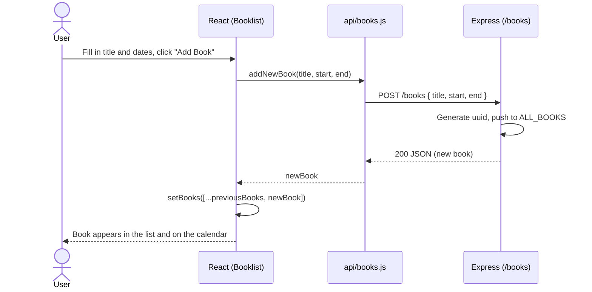

# BookNow – Book Club Reading Schedule

A Codecademy training project in which you act as the local book club president and need an efficient way to keep track of each book's title and reading schedule. A React front end connects to an Express back-end REST API and provides full CRUD (create, read, update, delete) functionality for the club's reading list, which is also shown on a calendar.

## Motivation

This project was created to put the concepts from Codecademy's *What is REST?* article into practice. The goal is to build the front-end functions that call the REST endpoints of a back-end API (`POST`, `GET`, `PUT`, `DELETE`) so that the book club's application can create, read, update and delete book schedules.

## Features

- List all books with their reading schedules (title, start date, end date).
- Add a new book with a title and a start and end date.
- Update the title and dates of an existing book.
- Delete a book from the schedule.
- Calendar view (month, week and day) showing every book's reading period.
- REST API with a `/books` resource, including fetching a single book by id.
- Books are kept in memory on the server (no database), so the list resets to a single sample book whenever the server restarts.

## Tech/framework used

**Built with:**

- [Node.js](https://nodejs.org/) v19 and JavaScript (ES6)
- [Express](https://expressjs.com/) 4.18 – REST API (back end)
- [cors](https://www.npmjs.com/package/cors), [morgan](https://www.npmjs.com/package/morgan) (request logging) and [uuid](https://www.npmjs.com/package/uuid) – back-end middleware and id generation
- [nodemon](https://www.npmjs.com/package/nodemon) – auto-restart of the back end during development
- [React](https://react.dev/) 18.2 with [Create React App](https://create-react-app.dev/) (`react-scripts` 5) – front end
- [Material UI](https://mui.com/) (`@mui/material`, `@mui/x-date-pickers`) with [date-fns](https://date-fns.org/) – form controls and date pickers
- [react-big-calendar](https://github.com/jquense/react-big-calendar) with [moment](https://momentjs.com/) – calendar view
- Data storage: in-memory array on the server (no database)

**Tested with:**

- [Jest](https://jestjs.io/) (via `react-scripts test`)
- [React Testing Library](https://testing-library.com/docs/react-testing-library/intro/), `@testing-library/jest-dom` and `@testing-library/user-event`

## Sequence diagram

Adding a new book:



## Code style

- **ESLint** is configured in the front end through Create React App (`react-app` and `react-app/jest` presets, see `eslintConfig` in `frontend/package.json`). Lint warnings are shown in the console when running `npm start`.
- The back end has no linter or formatter configured.
- No Prettier or EditorConfig configuration is present.
- Commit messages follow the [Conventional Commits](https://www.conventionalcommits.org/) convention (e.g. `feat: add deleteBook api function`).

## Installation

The project consists of two separate apps, `backend/` and `frontend/`, that each need their own dependencies and their own terminal.

1. Clone the repository and enter the project folder:

   ```bash
   git clone <repository-url>
   cd starting-code
   ```

2. Install the back-end dependencies:

   ```bash
   cd backend
   npm install
   ```

3. Install the front-end dependencies:

   ```bash
   cd ../frontend
   npm install
   ```

4. Configure the environment. No `.env` file is required. The back end listens on port `3000` by default, and the front end has the API address hard-coded in `frontend/src/api/index.js`:

   ```js
   export const API_ENDPOINT = "http://localhost:3000";
   ```

   Because the Create React App dev server also defaults to port `3000`, start the front end on a different port (see step 6). If you change the back end's port, update `API_ENDPOINT` to match.

5. There is no database to set up. Start the back end (from `backend/`):

   ```bash
   npm start
   ```

   The API is now available at <http://localhost:3000>.

6. In a second terminal, start the front end (from `frontend/`) on another port:

   ```bash
   PORT=3001 npm start
   ```

   Open <http://localhost:3001> in your browser.

## Tests

Tests exist for the front end only. From `frontend/`:

```bash
npm test
```

This runs Jest in interactive watch mode through `react-scripts`. To run once without watching:

```bash
CI=true npm test
```

> **Note:** [frontend/src/App.test.js](frontend/src/App.test.js) is still the default Create React App test that looks for the text "learn react", which `App` does not render, so it is expected to fail until it is replaced with real tests. The back end has no test script.

## Usage examples

### In the browser

1. Start both servers as described under [Installation](#installation) and open <http://localhost:3001>.
2. The calendar shows the sample book *JavaScript For Dummies* (November 1–5, 2021).
3. Under **Add a New Book to Read!**, enter a title, pick a start and end date and click **Add Book**. The book appears in the list and on the calendar.
4. Under **Existing Book Schedules**, edit the title or dates of a book and click **Update Book** to save, or click **Delete Book** to remove it.

### With curl

```bash
# List all books
curl http://localhost:3000/books

# Get one book
curl http://localhost:3000/books/<id>

# Add a book
curl -X POST http://localhost:3000/books \
  -H "Content-Type: application/json" \
  -d '{"title": "Eloquent JavaScript", "start": "2026-12-01", "end": "2026-12-15"}'

# Update a book (note the "new" prefix on the field names)
curl -X PUT http://localhost:3000/books/<id> \
  -H "Content-Type: application/json" \
  -d '{"newTitle": "Eloquent JavaScript, 4th ed.", "newStart": "2026-12-02", "newEnd": "2026-12-20"}'

# Delete a book
curl -X DELETE http://localhost:3000/books/<id>
```

## API reference

Base URL: `http://localhost:3000`. No endpoint requires authentication.

| Method | Path         | Auth | Description                                                                                          |
| ------ | ------------ | ---- | ---------------------------------------------------------------------------------------------------- |
| GET    | `/books`     | None | Returns all books as a JSON array.                                                                   |
| GET    | `/books/:id` | None | Returns a single book as JSON, or `404` if the id does not exist.                                    |
| POST   | `/books`     | None | Creates a book from the JSON body `{ title, start, end }` and returns the new book (with its `id`).  |
| PUT    | `/books/:id` | None | Updates a book from the JSON body `{ newTitle, newStart, newEnd }`. Returns `200`, or `404` if the id does not exist. |
| DELETE | `/books/:id` | None | Deletes a book. Returns `200`, or `404` if the id does not exist.                                    |

A book has the shape `{ id, title, start, end }`, where `id` is a UUID and `start`/`end` are ISO 8601 date strings. There is no input validation, and data is lost when the server restarts.

## Environment variables

| Name    | Required | Description                                                                                         |
| ------- | -------- | --------------------------------------------------------------------------------------------------- |
| `PORT`  | Optional | Port the back-end server listens on (default `3000`). Create React App also reads `PORT` for the front-end dev server, so set it per command, e.g. `PORT=3001 npm start` in `frontend/`. |
| `DEBUG` | Optional | Read by the [`debug`](https://www.npmjs.com/package/debug) module used in `backend/bin/www`; set to `books-backend:server` to log the listening address. |

## License

The back end declares the **ISC** license in `backend/package.json`. The front end is marked `private` and declares no license, and there is no `LICENSE` file in the repository.
